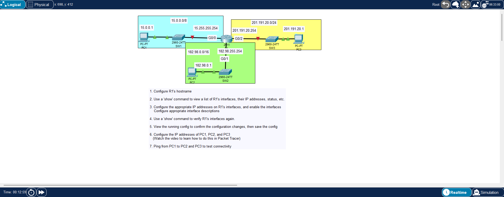
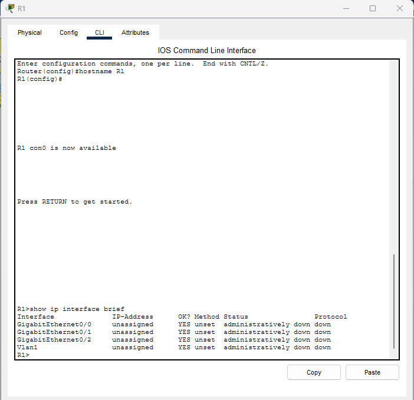
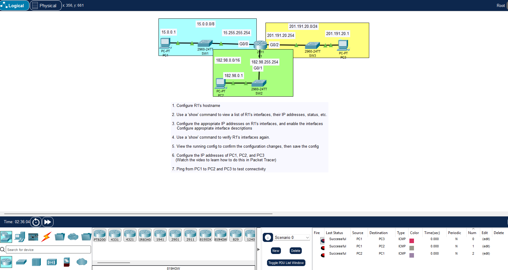

**File path:** `days/day-08-configuring-ip-addresses/lab.md`

# Day 8 Lab – Configuring IP Addresses

**Lab Source:** Jeremy’s IT Lab – Day 8 Lab  
**Lab Type:** Packet Tracer – Interface IP configuration and verification

---

## Lab Instructions

1. Configure R1's hostname

2. Use a `show` command to view a list of R1's interfaces, their IP addresses, status, etc.

3. Configure the appropriate IP addresses on R1's interfaces, and enable the interfaces.  
   Configure appropriate interface descriptions.

4. Use a `show` command to verify R1's interfaces again.

5. View the running config to confirm the configuration changes, then save the config.

6. Configure the IP addresses of PC1, PC2, and PC3.

7. Ping from PC1 to PC2 and PC3 to test connectivity.

---

## IP Addressing Used

| Device / Interface | IP Address         | Subnet Mask       | Network          |
|--------------------|--------------------|-------------------|------------------|
| R1 G0/0            | 15.255.255.254     | 255.0.0.0         | 15.0.0.0/8       |
| R1 G0/1            | 182.98.255.254     | 255.255.0.0       | 182.98.0.0/16    |
| R1 G0/2            | 201.191.20.254     | 255.255.255.0     | 201.191.20.0/24  |
| PC1                | 15.0.0.1           | 255.0.0.0         | 15.0.0.0/8       |
| PC2                | 182.98.0.1         | 255.255.0.0       | 182.98.0.0/16    |
| PC3                | 201.191.20.1       | 255.255.255.0     | 201.191.20.0/24  |

---

## Key Commands

| Task                          | Command                                      |
|-------------------------------|----------------------------------------------|
| Set hostname                  | `hostname R1`                                |
| View interfaces               | `show ip interface brief`                    |
| Configure interface           | `interface GigabitEthernet0/0`               |
| Set IP address                | `ip address x.x.x.x y.y.y.y`                 |
| Enable interface              | `no shutdown`                                |
| Add description               | `description Connection to SW1`              |
| Save config                   | `copy running-config startup-config`         |

---

## Screenshots

1. Lab topology with networks labeled
2. CLI – hostname configured + `show ip interface brief`
3. Final topology with green links + successful pings

---

## Verification Checklist

- [x] Hostname set to R1
- [x] Interfaces configured with correct IP addresses
- [x] Interfaces enabled
- [x] Configuration verified
- [x] PCs configured with correct IP addresses
- [x] Pings successful between PC1, PC2, and PC3

---

## Personal Notes

- Interfaces must be enabled with `no shutdown` (or via the GUI) before they come up.
- Different interfaces can use different subnet masks (/8, /16, /24) in the same lab.
- Successful pings confirm both Layer 2 and Layer 3 connectivity.

---

**Status:** Completed

---

## Image Links

---

## Screenshot Renaming Table

| New Filename                     | Original Filename   |
|----------------------------------|---------------------|
| `01-topology.png`                | `jitl0601.png`      |
| `02-cli-show-interfaces.png`     | `jitl0602.png`      |
| `03-final-topology-pings.png`    | `jitl0603.png`      |
